# GW//CONSOLE — HAProxy + Cloudflare Tunnel dashboard

One web UI to watch **and** manage your HAProxy and cloudflared gateways.
It runs on any small Linux host (VM, LXC or bare metal) and talks to the gateway nodes over SSH (key auth, no agents),
plus the Cloudflare API for edge health, DNS routes and traffic numbers. It also watches your sites and
your other servers (uptime, response time, CPU, memory, disks, services, certificates), records every
alert and can message you on Telegram or Discord.

```
            browser ──HTTP:8088──▶  gwconsole host ──▶ Telegram / Discord (alerts)
                                     │  SSH (key, from= locked, host key pinned)
                    ┌────────────────┼──────────────────┐
                    ▼                                   ▼
           HAProxy node(s)                     cloudflared node(s)
   admin socket · haproxy.cfg · systemd    config.yml per tunnel · systemd units
                                     │
                                     └── HTTPS ──▶ api.cloudflare.com (tunnels, DNS)
```

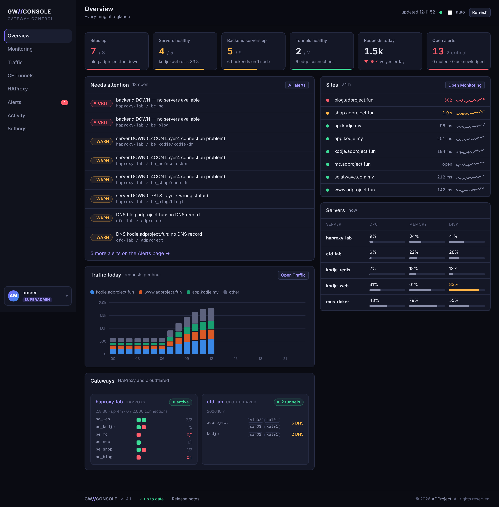

Your name at the bottom of the menu opens **My account**, Preferences, Signed-in browsers, What's new and Sign out. The footer shows the version and whether it's up to date.

## What it does

| Page | See | Do |
|---|---|---|
| **Overview** | Tiles for sites, servers, backend servers, tunnels, today's requests and alerts; what needs attention; sites with response times; today's traffic per hour; server CPU / memory / disk; every HAProxy backend's servers and every tunnel's edge connections | — |
| **Monitoring** | Every public hostname checked every minute, publicly (through Cloudflare) and internally (straight to the origin): status, response time, uptime 24 h / 7 days, certificate expiry. Every server's CPU load, memory, fullest disk, uptime and watched services. One graph with tabs (response time, CPU, memory, disk…) over 1 h – 7 days, with a Now / Average / Peak table | **+ Add a check**, per-site options (path, expected status, keyword, slow limit, don't check), watch a service, **Restart** a stopped one, check now |
| **Traffic** | Per site from Cloudflare: requests, visitors, bandwidth, cache share, 4xx/5xx, threats, countries. Per HAProxy frontend/backend: requests, data, 4xx/5xx, busiest hour. Today / 7 / 30 days / 12 months vs the previous period | Export CSV, refresh from Cloudflare |
| **CF Tunnels** | Every cloudflared tunnel (auto-discovered) with its edge connections, hostnames and today's requests; a detail panel shows each hostname's full route (cloudflared → HAProxy frontend → backend → servers up), its DNS state and whether the site is up. A **Hostnames** tab lists every public hostname end to end. Tunnels in your accounts that run nowhere you manage | **New tunnel**, **delete tunnel**, **add / remove hostname**, start / stop / restart, logs, test a URL, create/fix DNS route, delete orphan DNS records, **Edit config**, export CSV |
| **HAProxy** | Six status tiles (service, backends, connections, rates, traffic, version), then every frontend, backend and server with check status, sessions, rates, bytes, 2xx/4xx/5xx | **+ Add** a site or TCP service, **Edit / Delete** any frontend or backend, add/remove servers, server **ready / drain / maint** (kept after a restart), **reload** (config-checked first), restart, logs, **Edit config** |
| **Alerts** | Active and past alerts: what, when it started, how long it lasted, who acknowledged it | Acknowledge, mute an alert or a whole node, export CSV, check now |
| **Activity** | Every change (who, what, result, output), grouped by day | Search, filter by user / result / category / time, hide sign-ins, load more, export CSV |
| **My account** (every role) | Your profile and signed-in browsers | Change password, **two-step sign-in (2FA)**, preferences (clock, date style, time zone, start page, auto-refresh, **sign out when away**), sign out other browsers |
| **Settings** | Access (users, **what each user can manage**, sessions, sign-in security), Connections (nodes, Cloudflare accounts), Alerts (notifications, monitoring), System (general, backups, config history, about & updates) — superadmin only | Everything that used to be in config files, plus **updating the dashboard**, **backups and restore**, **monitoring thresholds** |

### Adding sites and editing HAProxy (no config typing)
**+ Add** on the HAProxy page opens one form for both halves of HAProxy:

- **Frontend** (where traffic comes in): *New*, *Use existing* or *None*.
- **Backend** (the servers behind it): *New*, *Use existing* or *None*.
- **Cloudflare** (optional): publish the hostname through a tunnel and create its DNS record, in the same step.

Choose **Website (HTTP)** to route a hostname to new servers on your existing frontend, or **TCP service** (a game server, a database…) for its own port. Typing the hostname fills in the backend name, the Cloudflare hostname and where cloudflared should send it.

Tabs cover what HAProxy can do without a wall of fields:

| Frontend | Backend |
|---|---|
| **Routing**: Host / path (starts, ends, exact, regex) / header / source IP / method / TLS SNI → send to backend, redirect, redirect to HTTPS, deny, allow only from IPs, set header; reorder; default backend | **Servers**: address, weight, max conn, check, **backup (DR)**; per server: HTTPS to server, SNI, PROXY protocol, check interval / rise / fall, cookie, start disabled |
| **Bind & HTTPS**: listen addresses, certificate, HTTP/2 (off by default — Cloudflare Tunnel already does TLS) | **Health check**: TCP connect or HTTP method / path / Host / healthy status |
| **Headers & redirects**, **Limits & timeouts** (max conn, timeouts, rate limit per IP, logging) | **Headers**, **Timeouts & retries**, sticky sessions by cookie |
| **Advanced** | **Advanced** |

The right side updates as you type: **what will happen** in plain words, **checks** (name free, hostname not routed elsewhere, HTTP/TCP modes match, port free, each server reachable from the HAProxy node) and the **exact haproxy.cfg diff**. **Review diff & apply** runs `haproxy -c`, then the usual safe apply. If the Cloudflare step fails, the HAProxy change is undone too.

**Edit** on any frontend or backend opens the same form with only that part. Anything the form has no field for stays in the **Advanced** tab exactly as written, and unchanged lines keep their exact formatting and position, so saving through the form never loses or reshuffles your config. **Delete** is refused while a backend is still used by a frontend. **+ server** and **✕** on a backend add or remove one server.

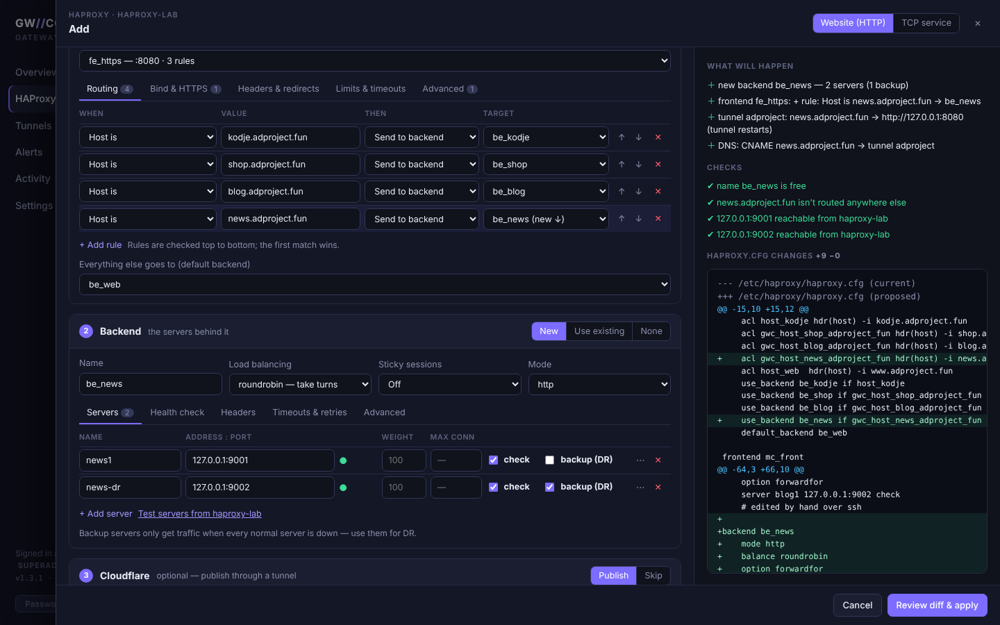

### Config editor (side panel)
**Edit config** on the HAProxy or Tunnels page slides the editor in over the live stats.

- **Editor tab**: validate → review the diff → apply.
- **History tab**: every backup, with who made the change that followed it and +/− line counts. Pick one to see what restoring it would change, then **Restore this version** (it goes through the same safe apply).

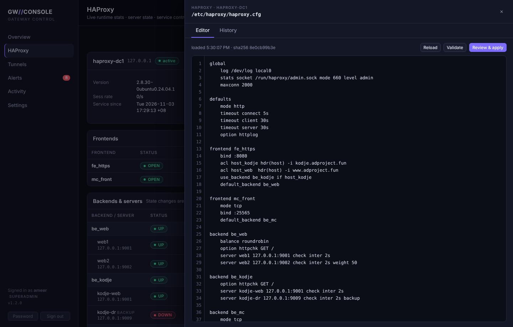

### Safe apply (HAProxy and cloudflared)
1. Upload to a temp file on the node and validate it there (`haproxy -c -f` / `cloudflared tunnel ingress validate`). Invalid → nothing changes.
2. Refuse if the file changed on the server since you opened it (someone edited over SSH).
3. Back up the current file to `gwc-backups/` (last 20 kept, configurable).
4. Write in place, then `systemctl reload haproxy` or `systemctl restart cloudflared-<name>`.
5. Wait, then check the service is still `active`. If reload or the check fails, it **restores the backup and reloads again automatically**.

Every change keeps running to the end even if you close the browser tab mid-way.
Server ready/drain/maint goes through the admin socket, so it only lasts until the next HAProxy restart.

### Alerts and notifications
A background checker runs every 30 s (configurable), even with no browser open.

- **One alert per problem**: an alert opens when a problem appears and resolves after it has been gone for two checks in a row. If it returns within 10 minutes, the same alert reopens (shown as *flapping*) instead of creating noise.
- **No false recoveries**: if a node is unreachable or the Cloudflare API is failing, alerts that depend on it stay open instead of resolving.
- **Acknowledge** marks "I'm on it". **Mute** an alert, or a whole node during maintenance (30 min – 7 days): it is still recorded but sends no messages.
- **Telegram / Discord** (Settings → Notifications): only new, escalated and resolved alerts are sent, combined into one message per check. Choose the minimum severity and whether to send recoveries for each channel.

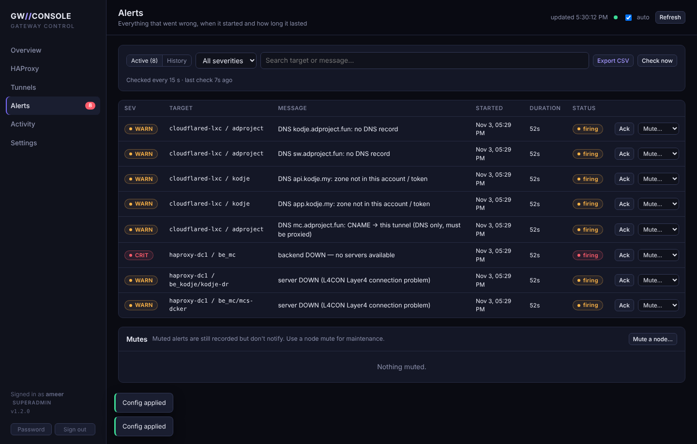

### My account and signing out when away
Everyone (viewer, operator, superadmin) has **My account**, in three tabs (Profile & password, Preferences, Signed-in browsers):
- change your password and turn on two-step sign-in;
- see your signed-in browsers and sign them out;
- set your preferences: 24-hour or 12-hour clock, date style, time zone, start page and auto-refresh.

**Sign me out when I'm away** (15 min to 8 h) signs you out after that long without a click or key press:
- you get a one-minute "Stay signed in" warning first;
- pages refreshing by themselves don't count as being there;
- the server checks it too, so a tab left open on another computer stays protected.

In Settings → Sign-in security a superadmin can set the longest time anyone may choose. It also applies to users who never chose one.

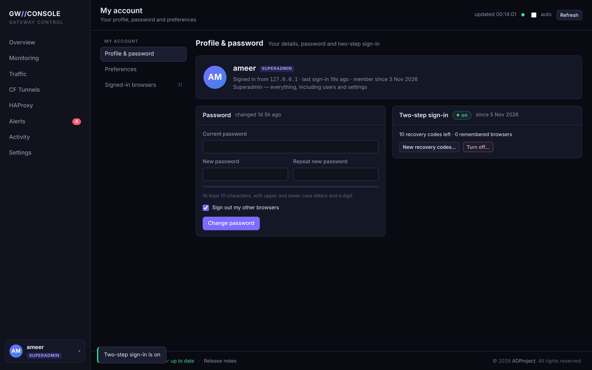

### Activity
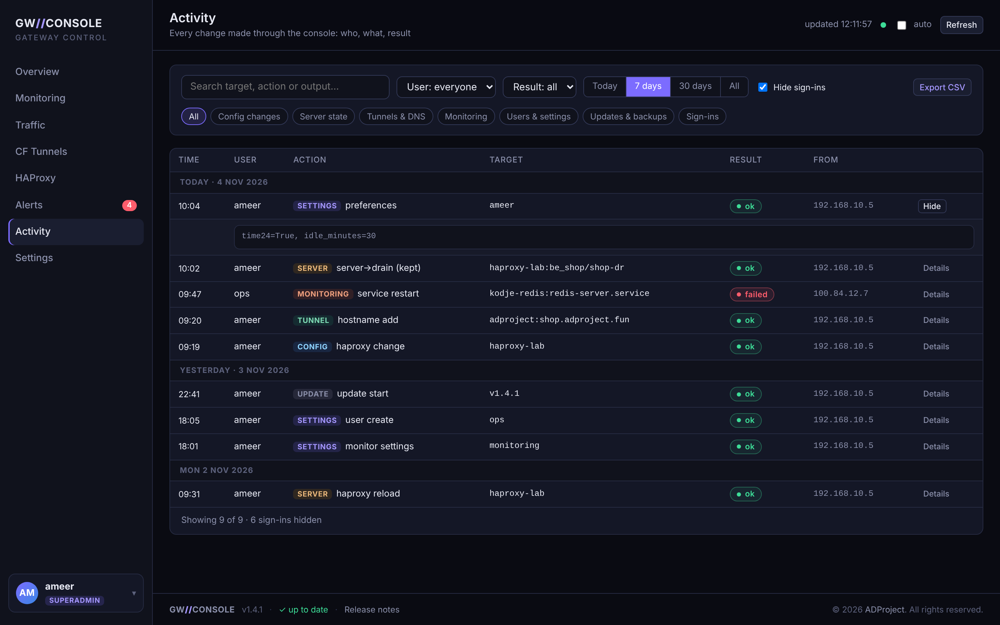

### Users and roles
| | Viewer | Operator | Superadmin |
|---|---|---|---|
| See all pages, logs, alerts, configs (read-only) | ✔ | ✔ | ✔ |
| Acknowledge / mute alerts | | ✔ | ✔ |
| Server state, reload/restart, edit configs, tunnels, hostnames, DNS routes | | ✔ | ✔ |
| Site checks and their options, watched services, restart a stopped watched service | | ✔ | ✔ |
| Users, Cloudflare accounts, nodes, notifications, monitoring thresholds, settings | | | ✔ |

New users and password resets get a temporary password that must be changed at first sign-in. Superadmins can see every signed-in session (grouped by user) and revoke it. The last active superadmin can't be demoted, disabled or deleted.

### What each user can manage (scoped access)
By default a viewer or operator can work on everything their role allows. **Settings → Users → Access…** limits a user to **only what you pick**:

- **Tunnels**: full control of that tunnel (start/stop/restart, logs, its hostnames and its config);
- **Domains**: `shop.example.com`, or `*.example.com` for everything below it (not `example.com` itself), wherever they are: tunnel routes, DNS records, HAProxy host rules and the backends only those hosts use;
- **Extra HAProxy backends** that no hostname points to (e.g. a TCP service).

A live preview shows exactly which hostnames, HAProxy rules and backends the user gets. Anything outside it is hidden on every page (Overview, HAProxy, CF Tunnels, Monitoring, Traffic, Alerts, Activity), and a banner tells the user what they can manage.

| | Limited user | Manages everything |
|---|---|---|
| Their own host rules on an HAProxy frontend ("Edit my rules") | ✔ | ✔ |
| Their backends' servers (ready / drain / maint) and settings | ✔ | ✔ |
| A backend other sites also use | 🔒 read only | ✔ |
| Add / remove hostnames on a tunnel | on their tunnels, for their domains | ✔ |
| Restart a tunnel, read its logs | only with the whole tunnel | ✔ |
| Reload / restart HAProxy, HAProxy logs, edit the raw HAProxy config, create / delete tunnels | | ✔ |

The role still decides *what kind* of change is allowed (a limited viewer only sees). Every refused action is written to Activity as **denied**. Superadmins always manage everything. Changes take effect on the user's next click.

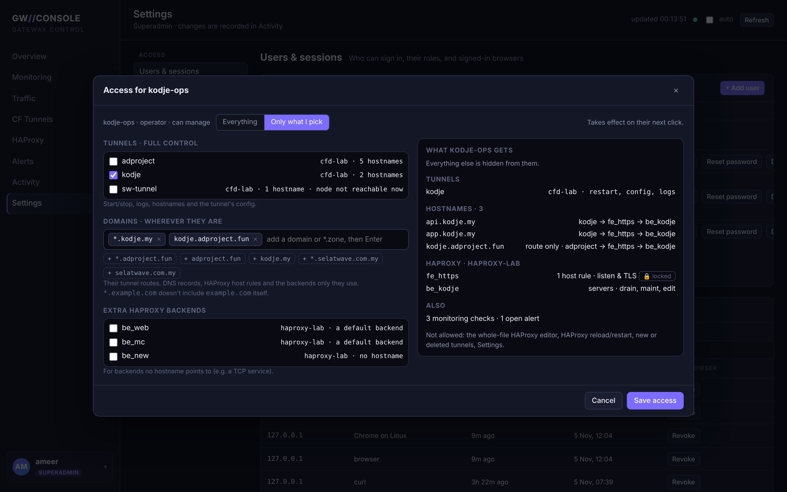

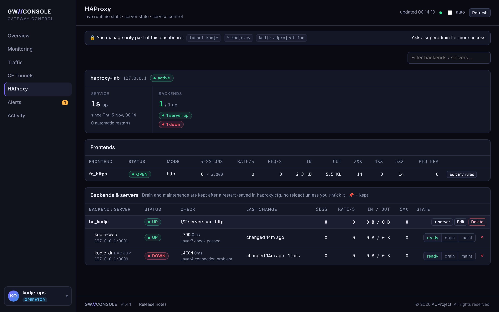

### Two-step sign-in (2FA)
**My account → Turn on two-step sign-in**: scan the QR code with any authenticator app (Google or Microsoft Authenticator, 1Password, Aegis…), type the 6-digit code, and save the **10 recovery codes** (Download or Copy; each works once). At sign-in you then type the code from the app; tick **Remember this browser for 30 days** to skip it on that browser.

- 5 wrong codes lock the code step for 5 minutes. Each code works only once.
- Turning it off needs your password and a code.
- **Settings → Sign-in security → Require two-step sign-in for**: nobody, superadmins (the default on new installs) or everyone. Someone who needs it is asked to set it up right after signing in. Installs upgraded from 1.4 start at "nobody"; a superadmin without two-step sign-in sees a reminder until it's on ("Not now" hides it for 30 days).
- Lost phone? A superadmin uses **Reset 2FA** in Settings → Users, or on the host `gwconsole reset-2fa <user>`.

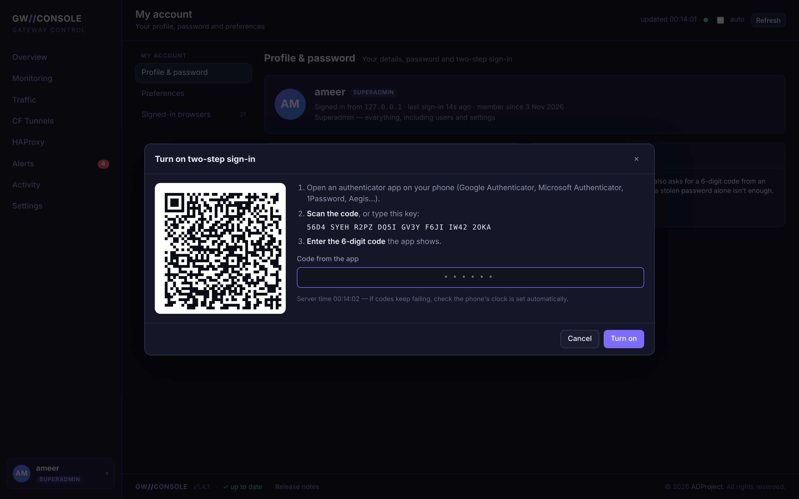

### Monitoring
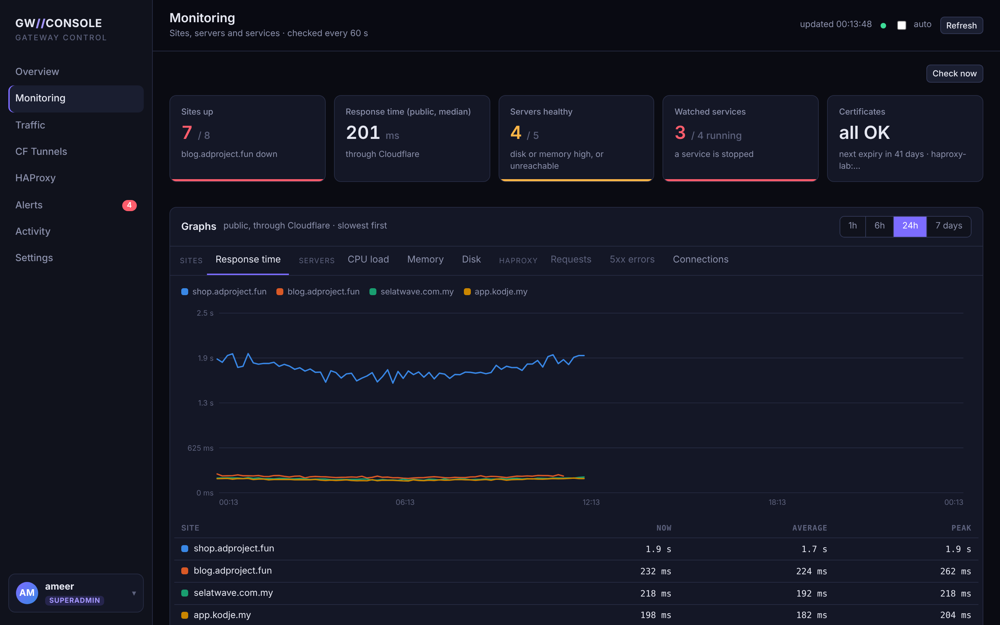

- **Sites** are found automatically from your tunnels' hostnames and your HAProxy host rules; add others with **+ Add a check**. Each one is checked every minute (Settings → Monitoring):
  - **public**: `https://hostname/` through Cloudflare, like a visitor;
  - **internal**: the tunnel's origin (e.g. `http://10.0.10.21:8080`) with the hostname as Host header, so you can tell "HAProxy is fine, Cloudflare isn't" from "the backend is down". TCP services (e.g. Minecraft) get a port check.
  - A site is **down** after 3 failed checks in a row and **slow** above 1.5 s (both adjustable, also per site). The public certificate's expiry is checked hourly.
- **Servers**: every node, including the new **Server** type for hosts that run neither HAProxy nor cloudflared (web, database, cache, game servers). Add them in Settings → Nodes like any other node; nothing gets installed on them. CPU load, memory, fullest disk and uptime are read over SSH every minute.
- **Watched services**: **+ service** on a server row picks systemd services to watch (it suggests what's running). A stopped one raises a critical alert and operators get a **Restart** button.
- **Alerts** (with mute, acknowledge and notifications like the others): site down / slow, backend 5xx share above 5 % for 5 min, disk 80 % / 90 %, memory 95 %, CPU load above 2× cores for 10 min, watched service stopped, certificate expiring in 14 / 3 days (HAProxy `.pem` files and public certificates), server unreachable.
- **Weekly summary** to Telegram/Discord (Monday 09:00 by default): uptime per site, incidents and the longest outage, busiest sites, the backend with the most 5xx, disks filling up.
- **History**: every minute for 48 hours, 15-minute averages for 30 days, daily traffic totals for a year — a few tens of MB in the same SQLite database.

### Traffic
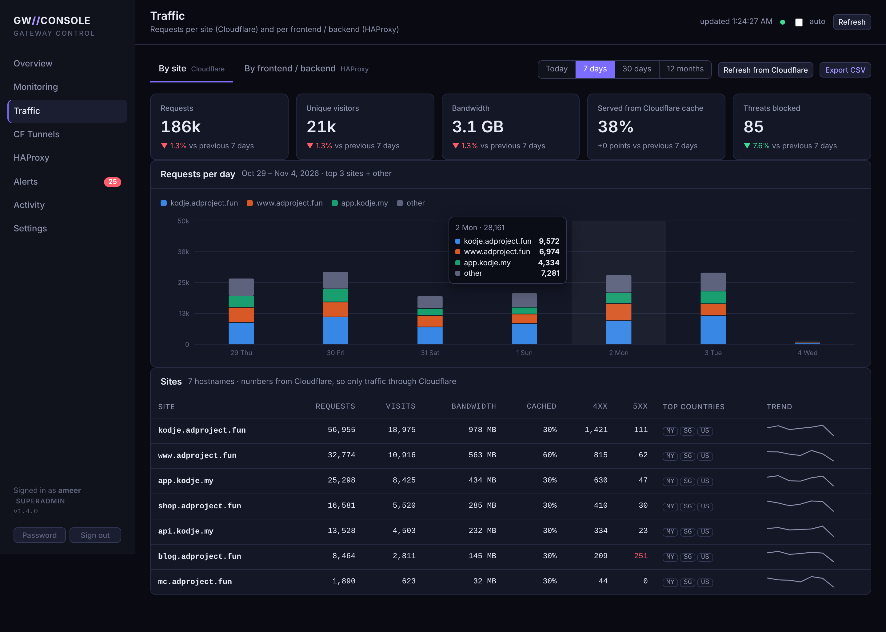

**By site** comes from Cloudflare's analytics (only traffic through Cloudflare); it needs the token permission **Zone → Analytics → Read** (see the token table below). **By frontend / backend** comes from HAProxy's own counters, so it also counts internal traffic and TCP connections, and keeps counting across reloads and restarts. Numbers start building up from the moment 1.4 runs; Cloudflare's last week is fetched on the first run.

### Managing tunnels
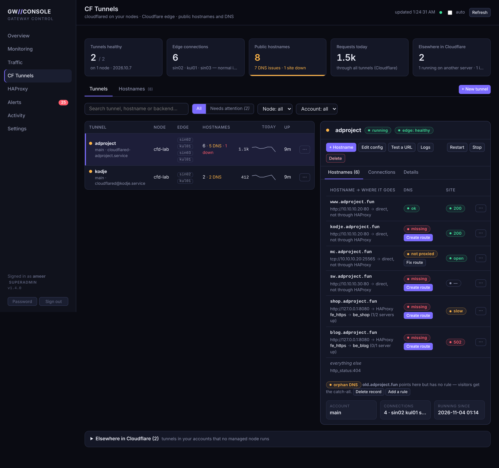

The **Hostnames** tab shows every public hostname end to end: DNS → tunnel → where cloudflared sends it → HAProxy frontend → backend → servers up → site status → today's requests.

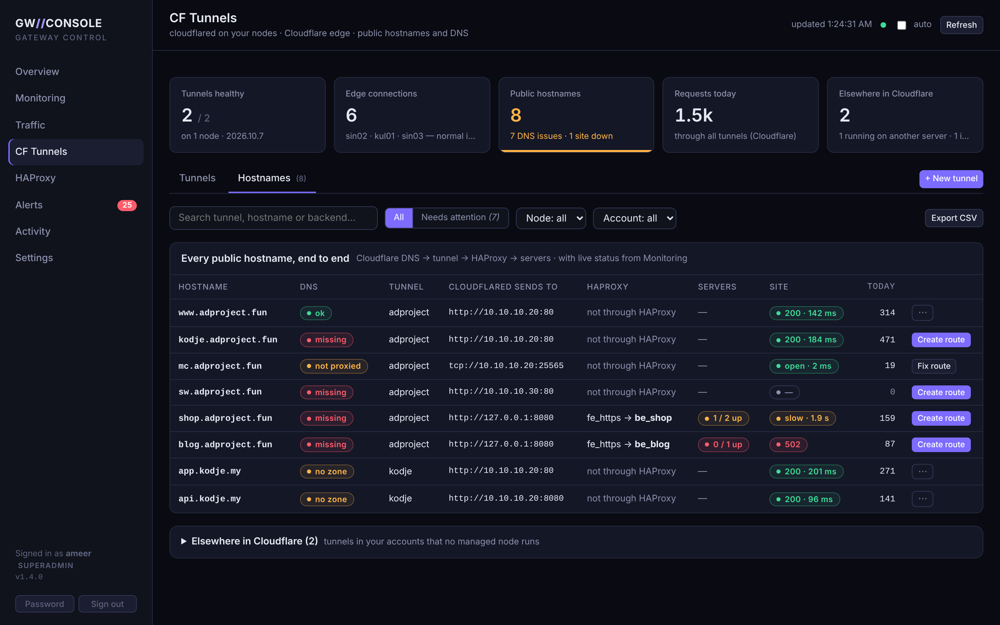

**New tunnel** (button on each cloudflared node): name, Cloudflare account, and optionally a first hostname and origin. The dashboard creates the tunnel through the Cloudflare API, writes the credentials (600) and `config.yml`, installs `cloudflared-<name>.service`, enables it, checks it is active and creates the DNS record. If anything fails, all of it is undone.

**+ Hostname / Remove** edits the ingress list (keeping your comments and indentation) through the safe-apply pipeline, and can create or delete the DNS record. It never repoints a record that belongs to another tunnel; that needs the explicit **Fix route** button.

**Delete** (type the name to confirm) stops the unit and moves its files into `<tunnel_base_dir>/.gwc-archive/<name>-<timestamp>/` (nothing erased), then optionally deletes the DNS records and the tunnel in Cloudflare.

**Token-run tunnels** (`cloudflared tunnel run --token …`) are detected and can be started, stopped or deleted; their hostnames live in the Zero Trust dashboard.

**Orphan DNS records** (pointing at a tunnel that has no rule for them) can be deleted, or turned into a hostname, from the tunnel's panel.

### Server state that survives a restart
On the HAProxy page, **drain** and **maint** are also written into `haproxy.cfg` (`weight 0` / `disabled`, the original weight is remembered) without a reload, so a later reload or restart doesn't bring the server back by surprise; **ready** undoes it. 📌 marks a kept state, and "file says …" warns when the running state and the file disagree. Untick **Keep after restart** in the confirmation for a runtime-only change.

### Updates, backups and config history
- **Update from the dashboard** (Settings → About & updates): a nightly check (or **Check now**) shows the new version's notes and the steps an update takes. **Update now** backs up, installs, restarts and checks that the new version answers; if it doesn't, it **goes back to the previous version automatically**. Telegram/Discord tell you when a new version is out. You can let bug-fix releases (x.y.**Z**) install themselves.
- **What's new**: after an update everyone sees a one-time banner with the changes. **Version history** lists every release with its notes, and **Update history** every upgrade on this dashboard (who, how long, rolled back or not).
- **Backups** (Settings → Backups): every night (the last 14 are kept) and before every update — settings, keys, users, nodes, accounts and alerts. Optionally copied to one of your nodes over SSH. **Download** gives a passphrase-encrypted file. Every backup is checked (opened and its database tested): **Made by** shows the version and **Check** shows verified or damaged; a damaged newest backup raises an alert.
- **Restore** (Settings → Backups): **Restore…** on any backup in the list (including the ones taken before each update), or drop a file (`.gwcbak` with its passphrase, or `.tar.gz`, up to 200 MB) from this or another Gateway Console. You see what's inside and what will be lost, then confirm with your password, your 2FA code and by typing RESTORE. The current state is saved first; the root helper checks the file again, restores it and starts the dashboard. If it doesn't answer within 60 s, the saved state is put back automatically. Everyone signs in again afterwards. A backup from a newer version is refused; a backup from another dashboard carries its own `secret.key`, so 2FA and saved tokens keep working only with that key. From the shell: `gwconsole restore <file>`.
- **Config history** (Settings → Config history): every change to `haproxy.cfg` and tunnel configs is also committed to a local git history, with who made it. If someone edits a file **outside the dashboard** (over SSH), you get an alert within 15 minutes; it's recorded in the history and you **Accept change** on the Alerts page.
- **Node software**: cloudflared on each node against the latest Cloudflare release, HAProxy against your OS packages. **Update cloudflared** restarts the tunnels one at a time and goes back to the old version if a tunnel doesn't come back.
- **Sign-in security**: a message when someone signs in from a new address or an address gets locked out, and an optional list of networks allowed to sign in.

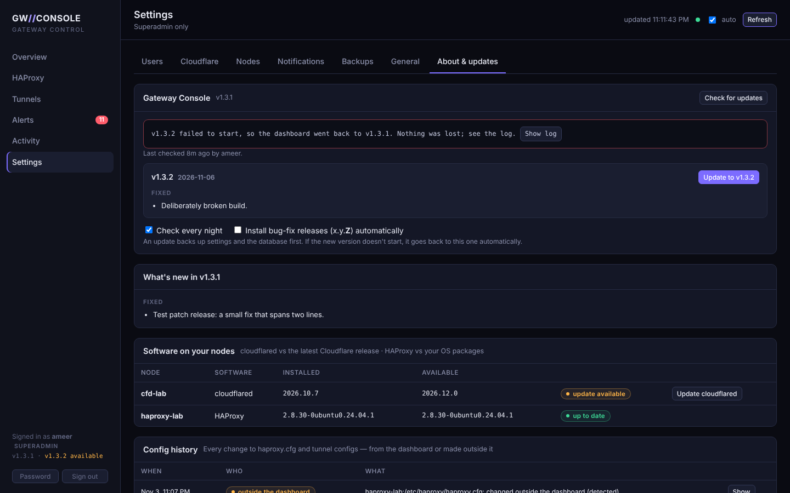

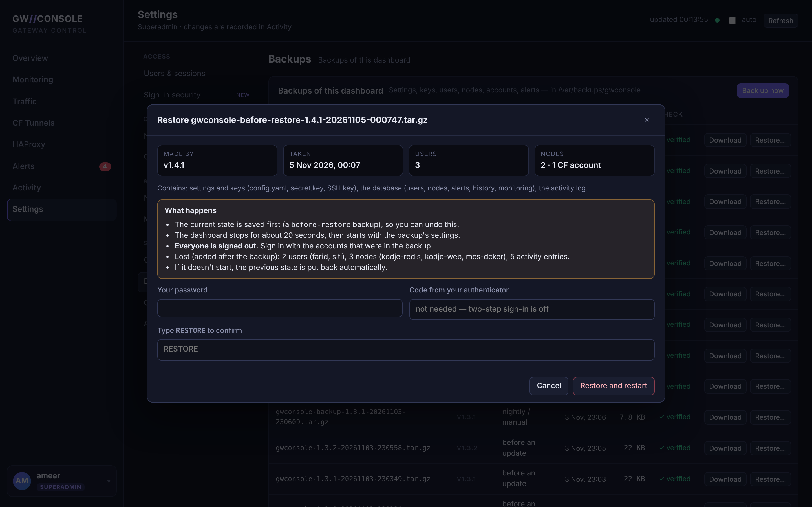

## Install

Any Linux host with **systemd** works — a VM, an LXC or bare metal: Debian 12+, Ubuntu 22.04+, or RHEL / Rocky / Alma / Fedora (Python 3.10+ is installed for you; 3.11 on RHEL 8/9). 1 vCPU and 512 MB is plenty. It only needs to reach the gateway nodes over SSH, and `api.cloudflare.com` if you use the Cloudflare features.

### 1. Get the code
The repo is private, so the host pulls it with a read-only **deploy key** (it can't push and can't see your other repos):

```bash
apt install -y git            # or: dnf install -y git
ssh-keygen -t ed25519 -N '' -f ~/.ssh/gwconsole_deploy -C "deploy@$(hostname)"
cat ~/.ssh/gwconsole_deploy.pub
#  → GitHub: repo → Settings → Deploy keys → Add deploy key (leave "Allow write access" OFF)
cat >> ~/.ssh/config <<'EOF'
Host github-gwconsole
  HostName github.com
  User git
  IdentityFile ~/.ssh/gwconsole_deploy
  IdentitiesOnly yes
EOF
git clone github-gwconsole:ameerdanial/gwconsole.git /root/gwconsole
cd /root/gwconsole && git checkout v1.5.0      # a tagged release
```

### 2. Run the installer
```bash
bash install.sh
```
It checks the host first (root, systemd, Python, free port, clock, Cloudflare reachable), then asks four things — **Enter keeps the default**:

```
==> a few questions (Enter keeps the default)
    This host's addresses: 192.168.10.50. 0.0.0.0 listens on all of them.
    Listen address: [0.0.0.0]
    Web port: [8088]
    Admin username: [admin] ameer
    Admin password:                  (10+ characters, upper + lower case and a digit)
    Repeat password:
```
If `ufw` or `firewalld` is active it offers to open the port. Then it installs, starts the service, waits until it answers and prints the address to open.

Unattended (Ansible, cloud-init…): pass everything as options and the password through the environment, never as an argument:
```bash
GWC_ADMIN_PASSWORD='…' bash install.sh --yes --admin ameer --port 8088 [--listen 10.0.0.5] [--no-firewall]
```

### 3. Finish in the browser (setup wizard)
Sign in and the dashboard walks you through three steps — skip any of them, all of it stays editable in **Settings**. Reopen the wizard any time from **Settings → General**.

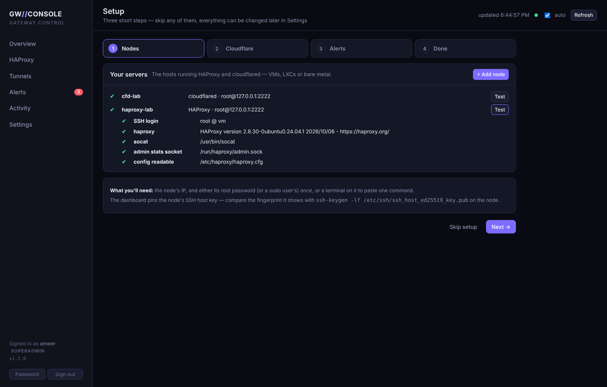

**Nodes.** **+ Add node** → type, name, IP → **Scan host key** and compare the fingerprint with `ssh-keygen -lf /etc/ssh/ssh_host_ed25519_key.pub` on the node. Then choose how the dashboard gets in:

- **Use the node's password once** (easiest): enter root's password, or a sudo user's. The dashboard logs in one time over the pinned host key, installs its SSH key (accepted only from the dashboard's IP), installs `socat`, sets up HAProxy's admin stats socket if it's missing (validated with `haproxy -c`, backed up, rolled back on error), proves the key works — and forgets the password. It's never stored or logged.
  Debian and Ubuntu don't let root log in with a password by default; give a sudo user instead and the dashboard still connects as root with its key (or as that user with passwordless sudo, if root can't log in over SSH at all).
- **Run a command on the node**: the form shows a one-liner to paste into a root shell on the node:
  ```bash
  curl -fsSL http://<dashboard>:8088/prepare-node.sh | bash -s -- --key "ssh-ed25519 AAAA… gwconsole@host" --from 192.168.10.50
  ```
  `prepare-node.sh` also runs on its own and asks for whatever is missing: `bash prepare-node.sh`.

Saving runs a connection test. If an HAProxy node's admin socket goes missing later, **Settings → Nodes → Test** and the HAProxy page show a **Fix it** button that makes the same safe change.

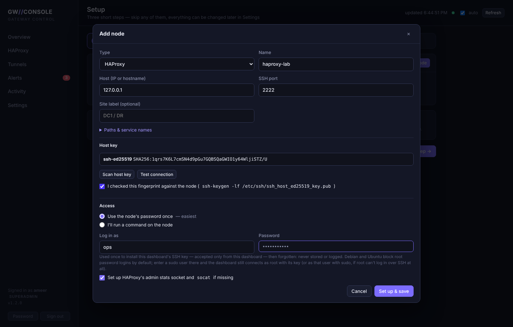

**Cloudflare** (optional): a name, the Account ID and an API token. **Test before saving** shows which permissions the token has.

- **Account ID**: dash.cloudflare.com → click a domain → right-hand column, **API** box → **Account ID** (also the long code in the address bar).
- **API token**: Profile → API Tokens → Create Custom Token:

| Permission | Level |
|---|---|
| Account · Cloudflare Tunnel | **Edit** (Read if you only want to watch) |
| Zone · Zone | Read |
| Zone · DNS | **Edit** (Read if you never create/fix/delete routes) |
| Zone · Analytics | Read (for the Traffic page) |

Tunnels are matched to their account automatically by the `tunnel:` ID in each `config.yml`.

**Alerts** (optional):
- **Telegram**: create a bot with @BotFather (bot token), message the bot once, get your chat ID from @userinfobot (groups: add @RawDataBot; the ID starts with `-100`).
- **Discord**: channel → Edit Channel → Integrations → Webhooks → New Webhook → Copy URL.

Use **Send test**. The last step also saves the dashboard URL so each message links back here.

## Upgrading

From 1.3 on: **Settings → About & updates → Update now**. It needs the `gwconsole-helper` units that `install.sh` sets up (a small root service that only knows "check", "upgrade to a tag" and "back up").

From the shell, or to get from 1.2 to 1.3 the first time:

```bash
gwconsole upgrade            # fetch, show what's new, confirm, back up, upgrade, restart
gwconsole upgrade v1.3.0     # a specific version
```
It runs `git fetch --tags --force` in the folder you installed from, shows the newest release with its `CHANGELOG.md` notes and asks before doing anything. The upgrade itself is `install.sh`: it stops the service, backs up `/etc/gwconsole` and the database to `/var/backups/gwconsole/` (last 10 kept), upgrades, starts it again and asks no questions.

By hand it's the same: `cd /root/gwconsole && git fetch --tags --force && git checkout vX.Y.Z && bash install.sh`.

**From 1.1 to 1.2**: nothing to do by hand. On first start, the users, nodes and Cloudflare accounts in your old `config.yaml` (and tokens from `/etc/gwconsole/env`) are imported into the database once. You sign in with the same password. From then on, manage them in Settings; the old sections in `config.yaml` are ignored but left in place.

**Going back from 1.5 to an older version** is refused while users with limited access exist, because the older version would give them everything. Set them to "Everything" first, or use `gwconsole upgrade v1.4.1 --force`.

**Rolling back**: `gwconsole upgrade v1.1.0` (or `git checkout v1.1.0 && bash install.sh`) works, because 1.1 still reads `config.yaml` (changes you made in the 1.2 Settings page are not carried back).

## Day-to-day

```bash
gwconsole status                # version, service state and the URL to open
gwconsole version               # installed version, e.g. "gwconsole 1.3.0 (v1.3.0)"
gwconsole users                 # list users and roles
gwconsole reset-password ameer  # locked out? set a new password (also re-enables the account)
gwconsole reset-2fa ameer       # lost the phone? turn off two-step sign-in for that user
gwconsole create-admin <user>   # add another superadmin from the shell
gwconsole check                 # test SSH to every node and every Cloudflare token
gwconsole backup                # back up now (also nightly, automatically)
gwconsole restore <file>        # put a backup back (saves the current state first, rolls back if it doesn't start)
gwconsole upgrade vX.Y.Z --force  # skip the downgrade check
gwconsole allow-all             # locked out by "allowed networks"? remove the restriction
gwconsole logs | restart
```

Where things live:

| What | Where |
|---|---|
| Bootstrap config (listen, port, paths) | `/etc/gwconsole/config.yaml` |
| Users, nodes, accounts, alerts, settings | `/var/lib/gwconsole/gwconsole.db` (SQLite) |
| Key that encrypts tokens/webhooks in the DB | `/etc/gwconsole/secret.key`. **Back it up with the DB.** |
| Dashboard SSH key | `/etc/gwconsole/id_ed25519` |
| Audit log | `/var/lib/gwconsole/audit.log` |
| Config backups on the nodes | `/etc/haproxy/gwc-backups/`, `/root/.cloudflared/<tunnel>/gwc-backups/` |
| Dashboard backups (nightly, before updates/restores) | `/var/backups/gwconsole/` |
| Uploaded backups waiting to be restored (deleted after 1 h) | `/var/lib/gwconsole/restore-spool/` |
| Config history (git) | `/var/lib/gwconsole/config-history/` — `git log -p` works there |
| Update helper state, log and update history | `/var/lib/gwconsole-helper/` (written by root, read by the dashboard) |
| Monitoring history and traffic numbers | in the database (tables `samples`, `samples_15m`, `traffic_daily`); retention in Settings → Monitoring |

## Version control & releases

- `main` holds the latest code. Every release is an annotated tag `vX.Y.Z` ([SemVer](https://semver.org/)); `VERSION` holds the current number, shown in the UI and by `gwconsole version`.
- Every commit touches one file and its message says what the file is for (`path: description`), so GitHub's file list doubles as documentation.
- `CHANGELOG.md` records what changed in each release. Add notes under **Unreleased** as you work.
- **CI** (GitHub Actions) runs on every push and PR: pytest on Python 3.11/3.12/3.13 (with a real `haproxy -c`), ruff, pip-audit, a compile check, and syntax checks for the shell scripts and every JS file.
- **Cutting a release:**
  ```bash
  ./release.sh 1.3.0           # dates the changelog, bumps VERSION, tags v1.3.0
  git push && git push --tags  # Actions builds gwconsole-v1.3.0.tar.gz and publishes a GitHub Release
  ```
- Tests: `pip install -r requirements-dev.txt && python -m pytest -q`.
- Secrets never go in the repo: `config.yaml`, `env`, keys, `secret.key` and `known_hosts` are git-ignored.

## Adding the DR site later
**Settings → Nodes → + Add node** for each DR node, with a site label like `DR`. Every page handles multiple nodes.

## Security notes
- This tool can reload and restart your gateways. Only expose it on the management VLAN or Tailscale, never publicly.
- Passwords are scrypt-hashed. Sessions are stored hashed in the database and survive restarts. 5 failed logins per IP lock that IP out for 5 minutes. Cookies are `HttpOnly` + `SameSite=Strict`, and every change also needs an `X-GWC` header.
- Roles are enforced on the server for every request; hiding buttons in the UI is only a convenience. So is scoped access: every API call is checked against what the user can manage, and an HAProxy change by a limited user is compared before and after, refusing anything that touches another site's rules or a shared backend. Refusals are audited as "denied".
- Two-step sign-in uses standard TOTP codes (RFC 6238). The secret is encrypted with `secret.key`, recovery codes are stored as scrypt hashes, each code works once, and wrong codes are rate-limited per user. Remembered browsers are stored hashed and forgotten when the password changes.
- The SSH key works only from the dashboard IP (`from=` in authorized_keys). Nodes added in Settings pin their host key; a changed key blocks the connection.
- "Use the node's password once" sends the password only over that pinned-host-key SSH session and keeps it in memory for that one request: it's never written to the database, logs or audit trail. A sudo password goes to `sudo` on stdin, never on a command line.
- `/prepare-node.sh` and `/api/health` are the only addresses served without a login; neither holds anything secret (the public key is passed as an argument).
- Cloudflare tokens, the Telegram bot token and the Discord webhook are encrypted in the database with `secret.key` (root:gwconsole 640). The app runs as the unprivileged `gwconsole` user in a hardened systemd unit.
- Updating and restoring need root, so the app can only *ask*: it writes one line (`check`, `upgrade vX.Y.Z`, `backup` or `restore <backup file name>`, plus who asked) that the root helper validates against a fixed pattern, and it only installs version tags that exist in your repository. A restore only takes a file name from the backup folder or the upload spool, and the helper checks the archive again itself (only the expected regular files, no links or `..`). Nothing else the app writes is ever run as root.
- **Allowed networks** (Settings → General) limits sign-in and every API call to the networks you list; the form refuses a list that would lock you out, and `gwconsole allow-all` on the host resets it.
- Downloaded backups are encrypted (scrypt + AES-256-GCM) with a passphrase you choose; they contain `secret.key`.

## Files
```
app/                  FastAPI backend + web UI (no build step, no CDN) — see app/README.md
tests/                pytest suite — see tests/README.md
docs/                 screenshots used in this README
.github/workflows/    CI and release automation
install.sh            interactive installer / upgrader for the dashboard host (any systemd Linux)
prepare-node.sh       one-time setup on each managed node (also served by the dashboard)
release.sh            cut a release (changelog, VERSION, tag)
config.example.yaml   bootstrap config template
gwconsole.service     systemd unit for the dashboard
systemd/              root helper (updates, backups) and the nightly timer
VERSION · CHANGELOG.md · requirements.txt · requirements-dev.txt
```
